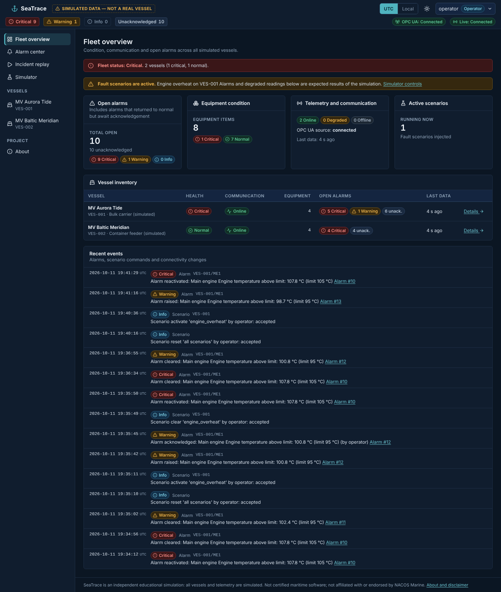
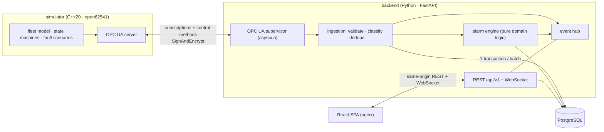

# SeaTrace — Maritime Automation Monitoring & Incident Replay

SeaTrace is a **simulated** fleet-monitoring platform. It answers the question an engineer asks after an alarm:
*what exactly happened to this machinery, before, during and after the event?*

A C++20 simulator models two vessels and their machinery and publishes it over **OPC UA**. A Python service collects
the data, validates it, stores it in **PostgreSQL**, runs an explicit alarm engine and serves a REST + WebSocket API. A React UI
shows live status, manages alarms with acknowledgement and audit trail, lets an operator inject faults, and **replays stored
incidents** on a synchronised timeline.

> **Disclaimer.** SeaTrace is an independent educational simulation. All vessels, equipment and measurements are
> simulated; operating ranges are illustrative and are not limits of any real equipment. It is not certified maritime software,
> must not be connected to safety-critical systems, and is **not affiliated with or endorsed by NACOS Marine.**



*Genuine screenshots of the running application (live simulator data). More in [`docs/screenshots/`](docs/screenshots/) — all
pages, desktop and mobile, dark and light.*

## What it demonstrates

| Capability | How it is implemented (all verified, see [Testing](#testing)) |
|---|---|
| Industrial data exchange | Real OPC UA server (`open62541`, C++20) ⇄ real client (`asyncua`): browsing, a data-change subscription with a `StatusValueTimestamp` filter, control **methods**, Basic256Sha256 SignAndEncrypt with certificate trust |
| Realistic, repeatable plant | Equipment state machines, coupled physics (cooling loss heats the engine), seeded deterministic noise, 9 fault scenarios incl. stuck / invalid sensors, telemetry interruption and a full OPC UA outage |
| Unreliable-data handling | Source vs. ingestion timestamps, idempotent writes, out-of-order & duplicate handling, quality flags (`good/uncertain/bad/invalid/stuck/stale`), bounded queues, bounded reconnect backoff, no duplicate subscriptions |
| Alarm management | Pure, unit-tested engine: persistence, hysteresis, dwell time, de-duplication, 4-state lifecycle where *clearing never implies acknowledging*, full audit trail — [docs/alarm-lifecycle.md](docs/alarm-lifecycle.md) |
| Incident investigation | Stored-telemetry replay: synchronised charts, alarm/state timeline, play/pause/speed/seek, "state at cursor" without interpolation, explicit gaps |
| Security basics | Argon2id, JWT, viewer/operator roles enforced server-side, throttled login, strict CORS, no secrets in git, production start-up guard rails |
| Explainable anomaly insight (experimental) | Combined vibration + temperature drift score that flags a developing fault ~20 s before the alarm in simulation — [docs/anomaly-detection.md](docs/anomaly-detection.md) |

## Architecture



**Actual data flow:** simulator tick → OPC UA `DataValue` (value, status code, *source* timestamp) → subscription
notification → bounded queue → validation/classification → one PostgreSQL transaction (telemetry + state changes + alarm
rows + audit) → in-memory latest cache and WebSocket broadcast → browser. Operator actions travel the other way:
UI → REST → backend service → OPC UA method call → simulator. Full description: [docs/architecture.md](docs/architecture.md),
address space: [docs/opc-ua-model.md](docs/opc-ua-model.md), schema: [docs/data-model.md](docs/data-model.md),
decisions and rationale: [docs/design-decisions.md](docs/design-decisions.md).

## Technology

C++20 / CMake / `open62541` 1.4 / GoogleTest · Python 3.13 / FastAPI / Pydantic / SQLAlchemy 2 (async) / Alembic /
`asyncua` · PostgreSQL 16 · React 19 / TypeScript / Vite / TanStack Query / ECharts · Docker Compose · GitHub Actions ·
Ruff, mypy, ESLint, Prettier, clang-format · pytest, Vitest, Playwright. Dependencies are pinned (lockfiles committed).

## Quick start (Docker Compose)

Prerequisites: Docker Engine ≥ 24 with the Compose plugin, ~2 GB free disk, outbound internet for the first build.

```bash
git clone <this repository> && cd SeaTrace
scripts/init-env.sh          # writes .env with random secrets and prints the demo logins
docker compose up --build    # add -d to run in the background
```

(`cp .env.example .env` also works for a throw-away demo: it uses placeholder passwords, accepted only while
`SEATRACE_ENV=development`.)

Then open **<http://localhost:8080>** and sign in as `operator` (or `viewer`) with the password printed by
`init-env.sh` (stored in `.env` as `SEATRACE_DEMO_OPERATOR_PASSWORD` / `SEATRACE_DEMO_VIEWER_PASSWORD`).

| URL | What |
|---|---|
| <http://localhost:8080> | Web UI (nginx; also proxies `/api` and the WebSocket) |
| <http://localhost:8000/api/v1/docs> | Interactive OpenAPI docs (Swagger UI; loads its assets from a CDN, so it needs internet) |
| `opc.tcp://localhost:4840` | Simulator OPC UA endpoint (loopback only; Basic256Sha256 SignAndEncrypt, the dev certificates are in the `pki` volume) |

Start-up order is handled by Compose health checks: `db` → `pki-init` (dev certificates) → `simulator`;
`migrate` (Alembic, one-shot) → `backend` → `frontend`. Data lives in the `pgdata` volume; `docker compose down` keeps it,
`docker compose down -v` wipes it. Stop everything with `docker compose down`.

> **Verified in this repository's development sandbox:** the stack was brought up with Docker (build, health checks,
> secure OPC UA link), the black-box smoke test and the 5 Playwright browser specs passed against `http://localhost:8080`, and
> backend restart, database stop/start and an OPC UA outage were exercised end-to-end. See [Testing](#testing) for the exact
> results and the one sandbox-specific caveat about BuildKit.

### Run without Docker

```bash
scripts/dev-stack.sh start    # builds the simulator if needed, migrates, starts simulator + backend (needs PostgreSQL)
cd frontend && npm ci && npm run dev    # UI on http://localhost:5173 (proxies /api to :8000)
scripts/dev-stack.sh stop
```
Defaults and overrides are documented at the top of `scripts/dev-stack.sh` (database admin URL, ports, OPC UA security mode).

## Using it

1. **Fleet overview** — vessels, health, communication, open alarms by severity, recent events.
2. **Vessel details** — equipment states, latest readings (value · unit · quality · source time · age), nominal-range bars,
   charts, per-equipment alarms, experimental anomaly insight.
3. **Alarm center** — Open / History, filters (severity, state, vessel, equipment, kind) that change the API query, acknowledgement
   with note, full transition history, "condition active / returned to normal".
4. **Incident replay** — pick an alarm or a window; play, pause, change speed (0.5×–30×), seek, step sample-by-sample.
5. **Simulator** — connection status, scenario catalogue, activate / clear / reset, command audit trail. (Operator only.)

### Fault scenarios

| Scenario | Target | What you should see |
|---|---|---|
| `engine_overheat` | ME1 | temperature climbs → `ME_TEMP_HIGH` (warning) → `ME_TEMP_HIGH_HIGH` (critical) → protective **trip** after sustained over-temperature |
| `engine_vibration` | ME1 | vibration ramps to ≈ 2.5× nominal and temperature creeps up → anomaly insight first, then `ME_VIB_HIGH` |
| `cooling_pressure_loss` | COOL1 | pressure decays → `COOL_PRESS_LOW*`; engine temperature drifts up (coupled physics) |
| `bilge_flooding` | BILGE1 | ingress exceeds pump capacity → `BILGE_LEVEL_HIGH*` |
| `sensor_stuck` | ME1 temperature | flat-line detected → `SENSOR_QUALITY` |
| `sensor_out_of_range` | COOL1 pressure | impossible value rejected as `invalid` → `SENSOR_QUALITY` |
| `sensor_failure` | GEN1 power | OPC UA `BadSensorFailure` → `SENSOR_QUALITY` (fastest: ~5 s) |
| `telemetry_interruption` | whole vessel | values go stale → `SOURCE_COMM_LOSS`, then self-recovers (default 60 s) |
| `opcua_outage` | whole server | listener stops; backend reconnects with backoff (default 20 s) |

Default alarm thresholds, hysteresis and timers are listed in [docs/alarm-lifecycle.md](docs/alarm-lifecycle.md) and are
simulation examples. A guided walkthrough is in [docs/demo-script.md](docs/demo-script.md).

## Configuration

All configuration is environment-driven. `.env.example` documents every variable used by Compose.

| Variable | Purpose |
|---|---|
| `SEATRACE_ENV` | `development` or `production`. In `production` the backend **refuses to start** with placeholder secrets, a short `SECRET_KEY`, `*` in CORS origins, or an unsecured OPC UA link |
| `POSTGRES_*` | Database credentials (URL-safe characters only) |
| `SEATRACE_SECRET_KEY` | Signs access tokens (≥ 32 random characters in production) |
| `SEATRACE_DEMO_{OPERATOR,VIEWER}_{USERNAME,PASSWORD}` | Demo accounts, created/refreshed at start-up; empty password = no account |
| `SEATRACE_HTTP_PORT` | Host port of the web UI (default 8080) |
| `SIM_SECURITY_MODE` | `secure` (default, SignAndEncrypt + certificate trust) or `none` (development only) |
| `SIM_SEED`, `SIM_TICK_MS` | Simulator RNG seed (deterministic noise) and tick period |
| `SIM_CONTROL_USER/PASSWORD` | Account the backend uses to call simulator control methods |

Further backend settings (`SEATRACE_STALE_AFTER_S`, `SEATRACE_INCIDENT_MAX_WINDOW_S`, retention, queue sizes, OPC UA backoff…)
are in `backend/app/config.py`. Alarm rules live in the `alarm_rules` table (seeded once; tune them in the database).

### Database migrations
Alembic owns the schema. Compose runs `alembic upgrade head` in the one-shot `migrate` service before the backend starts.
Manually: `cd backend && SEATRACE_DATABASE_URL=postgresql+asyncpg://… uv run alembic upgrade head`. New revision:
`uv run alembic revision --autogenerate -m "…"` (review the result; `tests/test_migrations.py` fails on model/migration drift).

## Security boundaries (read this before exposing anything)

* **This is an educational simulation, not a hardened product.** Local, single-host deployment is the intended use.
* OPC UA: `secure` mode uses **self-signed development certificates** generated by `scripts/gen-dev-certs.sh` into a Docker volume, with
  explicit trust of the backend's certificate. A real deployment needs a proper PKI (CA, revocation, rotation), network segmentation
  and an OPC UA server from the equipment vendor. `SIM_SECURITY_MODE=none` sends the control password in clear text — development only.
* The control account is used by the backend for all OPC UA traffic; anonymous clients may read but cannot call methods.
* Access tokens (JWT, 8 h) live in the browser's `sessionStorage` (XSS trade-off documented in [docs/frontend.md](docs/frontend.md)); there
  is no refresh/revocation. The web port is plain HTTP — put TLS in front (reverse proxy) for anything beyond localhost.
* Passwords are Argon2id-hashed; secrets come only from the environment; logs redact password/token-like fields; errors never expose
  stack traces.
* Do not connect SeaTrace to real, let alone safety-critical, onboard equipment.

## Testing

| Suite | Command | Result recorded during development |
|---|---|---|
| C++ simulator (unit + in-process OPC UA) | `cmake -S simulator -B simulator/build -G Ninja && cmake --build simulator/build && ctest --test-dir simulator/build` | **146 / 146 passed** (also 27 OPC UA tests under ASan/UBSan) |
| Backend (unit, API, DB, migrations, OPC UA, WebSocket) + **integration with the real simulator** | `cd backend && uv run pytest` | BACKEND_RESULT |
| Backend static checks | `uv run ruff check app tests scripts && uv run ruff format --check app tests scripts migrations && uv run mypy` | clean (ruff, mypy `--strict`) |
| Frontend | `cd frontend && npm ci && npm run lint && npm run typecheck && npm test && npm run build` | **278 / 278 tests**, lint/typecheck/format/build clean; coverage 93.6 % statements |
| Browser e2e (Playwright, real Chromium) | `E2E_OPERATOR_PASSWORD=… E2E_VIEWER_PASSWORD=… BASE_URL=http://localhost:8080 npx playwright test` (in `frontend/`) | **5 / 5 passed** against the Docker Compose stack: login rules, live fleet, fault → alarm → acknowledge → audit → replay → clear, viewer restrictions |
| Black-box smoke | `python3 scripts/smoke_test.py --base http://localhost:8080` | `SMOKE OK` on the Compose stack |

The backend integration tests start the real C++ binary and verify: measurements reach PostgreSQL and the API; a fault produces an
alarm that is acknowledged with an audit record and replayed from stored data; cooling loss heats the engine; telemetry interruption → stale
→ communication alarm → recovery (with the gap visible in replay); an OPC UA outage is reported and the backend reconnects with exactly one
subscription; stuck/out-of-range sensors are detected; secure mode works and an untrusted client certificate is rejected.
[docs/testing.md](docs/testing.md) maps every required failure mode to its test.

Backend tests need PostgreSQL (they create and drop their own `seatrace_test_*` database; set `SEATRACE_TEST_DATABASE_URL`
to an admin URL, see the doc). CI (`.github/workflows/ci.yml`) runs all of the above plus a Compose end-to-end job.

**Sandbox caveat (honest note).** In the restricted container used to develop this project the BuildKit builder intermittently failed
on `npm ci` / `pip install` (TLS-intercepting egress proxy); the same Dockerfiles built successfully with the legacy builder
(`DOCKER_BUILDKIT=0 docker build --network=host …`). On a normal machine `docker compose up --build` is the supported path.

## Troubleshooting

| Symptom | Fix |
|---|---|
| `docker compose` complains about `POSTGRES_PASSWORD` / `SEATRACE_SECRET_KEY` | Run `scripts/init-env.sh` (or copy `.env.example` to `.env`) |
| Port 8080/8000/4840 already in use | Change `SEATRACE_HTTP_PORT`, or stop the other process; the backend and OPC UA ports are bound to 127.0.0.1 |
| UI shows everything *offline/stale* | Check `docker compose ps` and `docker compose logs simulator backend`; the OPC UA chip in the top bar shows the connection state and last error |
| Backend logs `OPC UA unavailable; retrying` | Normal while the simulator is starting or during the `opcua_outage` scenario; backoff is bounded (1 s → 30 s) |
| Changed `SIM_SECURITY_MODE` and the link fails | The mode must match for both services (Compose passes the same variable to both); `docker compose up -d --force-recreate simulator backend` |
| Want to regenerate certificates | `docker compose down`, `docker volume rm seatrace_pki`, `docker compose up` |
| Login says "too many attempts" | Throttle is 5 failures / minute per client and username; wait a minute |
| Swagger UI is blank | Its JavaScript comes from a CDN; the raw schema is always at `/api/v1/openapi.json` and in `docs/openapi.json` |

## Known limitations

* Everything physical is simulated, including limits. No claim of real-world validity (see [design decisions](docs/design-decisions.md#what-is-simulated-and-what-would-need-validation-on-a-real-vessel)).
* One backend process; the event hub, login throttle and alarm-engine timers are in memory (a restart conservatively restarts debounce timers;
  open alarms and history are restored from PostgreSQL). Horizontal scaling would need a shared hub (e.g. PostgreSQL `LISTEN/NOTIFY`) and
  leader election for the alarm engine.
* Alarm rules are editable in the database only (read-only in the API/UI) and need a restart to take effect.
* Replay windows are limited to 2 h of raw 1 Hz data per request; the telemetry table is not partitioned (retention job available).
* Compose publishes plain HTTP; TLS termination is left to a reverse proxy.
* Compose was exercised on a single Linux host; Windows/macOS Docker Desktop was not tested.
* The anomaly score is a transparent heuristic calibrated on simulated signals only.

## Future improvements

Time-partitioned telemetry and continuous aggregates; editable alarm rules with change audit; shift/area-based alarm shelving and suppression;
OPC UA historical access and alarms & conditions (Part 9) as an alternative source; a second protocol adapter (e.g. Modbus/NMEA 2000
gateway); persisted anomaly scores and a validated model on labelled simulator runs; OIDC login; OpenTelemetry traces/metrics; Helm chart.

## Repository layout

```
simulator/   C++20 simulator + OPC UA server (src/core, src/opcua, tests, Dockerfile, fleet.json)
backend/     FastAPI app (app/api, domain, services, opcua, realtime, db), Alembic migrations, tests
frontend/    React + TypeScript SPA, Vitest tests, Playwright e2e, Dockerfile + nginx.conf
docs/        architecture, OPC UA model, alarm lifecycle, data model, testing, design decisions, demo script, OpenAPI, screenshots
scripts/     init-env.sh, gen-dev-certs.sh, dev-stack.sh, smoke_test.py
compose.yaml .env.example Makefile .github/workflows/ci.yml
```

---
Independent portfolio project · simulated data only · not affiliated with or endorsed by NACOS Marine.
