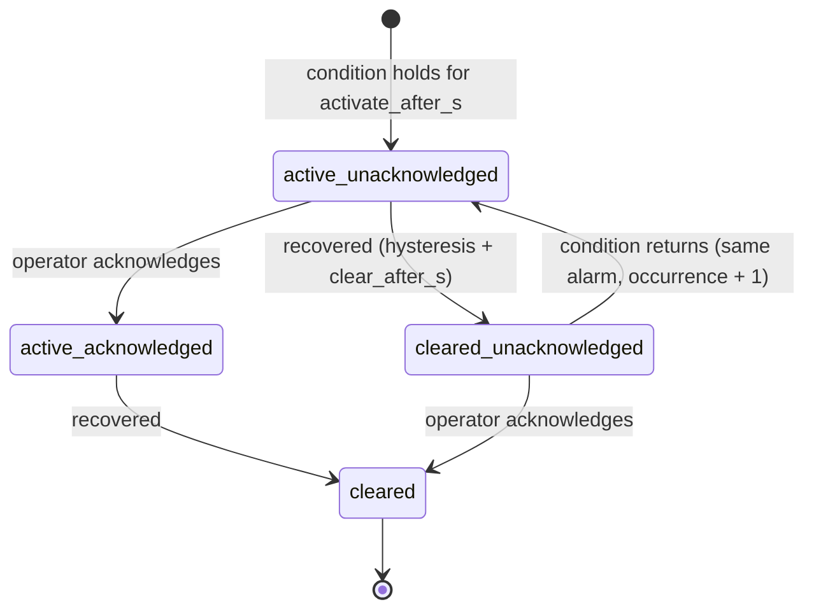

# Alarm lifecycle

The alarm engine (`backend/app/domain/alarms.py`) is a pure state machine: it performs no I/O, never reads the
clock and is unit-tested in isolation (`backend/tests/test_alarm_engine.py`). Persistence, de-duplication in the
database and publication to WebSocket clients are layered on top (`app/services/alarm_service.py`).

## States

SeaTrace follows the ISA-18.2 / EEMUA 191 idea that *"the condition is gone"* and *"an operator has seen it"* are
two independent facts. The state is the combination of both:

| State | Condition active? | Acknowledged? | Meaning |
|---|---|---|---|
| `active_unacknowledged` | yes | no | New alarm, needs operator attention |
| `active_acknowledged` | yes | yes | Operator has seen it, condition persists |
| `cleared_unacknowledged` | no | no | Process returned to normal **but nobody acknowledged it yet** – stays on the list |
| `cleared` | no | yes | Closed. Remains in the history forever |

Rules that follow from this:

* **Clearing never acknowledges.** A condition that goes away on its own leaves the alarm in
  `cleared_unacknowledged`; `acknowledged_by` / `acknowledged_at` stay empty, so the audit trail can never imply an
  operator acted when nobody did.
* **Acknowledging never clears.** Acknowledging an active alarm only silences the "needs attention" aspect.
* Acknowledging an already acknowledged or closed alarm is rejected with `409 alarm_already_acknowledged` (and writes
  no audit row).
* History is append-only: every transition is stored in `alarm_events` with the actor (`system` or the username),
  the event time, the measurement value and, for acknowledgements, an optional operator note.

## Detection: persistence, hysteresis, de-duplication

Every rule (table `alarm_rules`, seeded from `app/domain/seed_catalog.py`, editable in the database) has:

| Field | Purpose |
|---|---|
| `threshold` | Activation limit (`gt` = above, `lt` = below) |
| `clear_threshold` | **Hysteresis**: the value must pass this (further inside the normal range) before recovery starts. Between `clear_threshold` and `threshold` the engine holds its current state |
| `activate_after_s` | **Persistence / debounce**: the condition must hold continuously (measured in *source* time) before an alarm is raised. A single blip resets the timer |
| `clear_after_s` | **Dwell time** for recovery. Re-entering the dead band restarts it |
| `severity` | `info` / `warning` / `critical` |

De-duplication happens at three levels:

1. Engine: one alarm per `(rule, equipment, sensor)`; while it is open, further violating samples only update it.
2. Reactivation: if a `cleared_unacknowledged` alarm's condition returns, the **same** alarm is reactivated
   (`reactivated` event, `occurrence_count + 1`) rather than creating a second record.
3. Database: a partial unique index `uq_alarms_open_per_source (rule_id, equipment_id, COALESCE(sensor_id,0)) WHERE state <> 'cleared'`
   makes duplicates impossible even if application logic had a bug.

Late / duplicate samples (source timestamp not newer than what was already evaluated for that sensor) are stored in
the history but **not** replayed into the state machine, so replays or re-subscriptions cannot re-trigger alarms.

Samples whose quality is `bad`, `invalid` or `stuck` are ignored by threshold rules (garbage must neither raise nor
clear a process alarm) and are handled by the data-quality rule instead.

## Alarm kinds

| Kind | Rule(s) | Trigger |
|---|---|---|
| `condition` | `ME_TEMP_HIGH(_HIGH)`, `ME_VIB_HIGH(_HIGH)`, `COOL_PRESS_LOW(_LOW)`, `BILGE_LEVEL_HIGH(_HIGH)` | Threshold on a good-quality measurement |
| `data_quality` | `SENSOR_QUALITY` | Per sensor: Bad OPC UA status, implausible value, or flat-lined (stuck) signal |
| `communication` | `SOURCE_COMM_LOSS` | No fresh telemetry for an equipment item for > 10 s (wall-clock; evaluated every second) |

Default numbers are **illustrative simulation parameters**, not operating limits of real equipment.

## Default rules

| Code | Equipment / measurement | Raise | Clear | Severity |
|---|---|---|---|---|
| `ME_TEMP_HIGH` | Main engine temperature | > 95 °C for 5 s | < 90 °C for 5 s | warning |
| `ME_TEMP_HIGH_HIGH` | Main engine temperature | > 105 °C for 3 s | < 100 °C for 5 s | critical |
| `ME_VIB_HIGH` | Main engine vibration | > 7.1 mm/s for 5 s | < 6.0 mm/s for 5 s | warning |
| `ME_VIB_HIGH_HIGH` | Main engine vibration | > 11 mm/s for 3 s | < 9 mm/s for 5 s | critical |
| `COOL_PRESS_LOW` | Cooling pressure | < 1.8 bar for 5 s | > 2.0 bar for 5 s | warning |
| `COOL_PRESS_LOW_LOW` | Cooling pressure | < 1.2 bar for 3 s | > 1.5 bar for 5 s | critical |
| `BILGE_LEVEL_HIGH` | Bilge water level | > 40 cm for 5 s | < 30 cm for 5 s | warning |
| `BILGE_LEVEL_HIGH_HIGH` | Bilge water level | > 70 cm for 3 s | < 55 cm for 5 s | critical |
| `SENSOR_QUALITY` | any sensor | bad/invalid/stuck for 3 s | good for 5 s | warning |
| `SOURCE_COMM_LOSS` | any equipment | silent > 10 s | fresh data for 3 s | critical |

## Failure handling

* The engine mutates in memory first; the database transaction (telemetry + alarm rows + audit rows) commits
  afterwards. On **any** persistence failure the engine is rolled back to a snapshot taken before the batch, so
  memory and database cannot diverge; the batch is retried (bounded) before being dropped and counted.
* After a backend restart, open alarms are re-adopted from the database (`AlarmService.restore`). Pending
  persistence/dwell timers are intentionally not persisted – a restart conservatively restarts debounce timing,
  but never duplicates or silently closes an open alarm.
* `alarm_events.recorded_at` is the database insertion time, `event_ts` the time the event is *about*, so the
  trail distinguishes source time from processing time.
