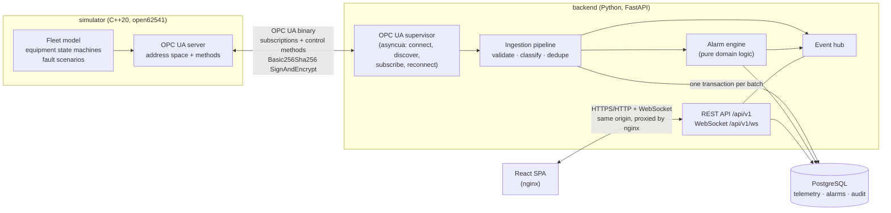

# Architecture

SeaTrace is deliberately a small number of well-separated components, not a distributed system: one native
simulator process, one Python service (OPC UA client + domain logic + API), PostgreSQL and a static web UI.



## Actual data flow

1. **Simulation.** `simulator/` advances the model once per tick (default 1 s). Equipment objects
   (main engine, generator, cooling system, bilge) own explicit state machines; measurements are derived from
   those states and from each other (cooling loss raises engine temperature). A seeded RNG makes runs repeatable.
2. **OPC UA server.** After each tick the simulator writes `DataValue`s (value, status code, *source* timestamp) to
   the address space described in [opc-ua-model.md](opc-ua-model.md). Fault scenarios are started/stopped through OPC UA
   *methods* callable only by the control account.
3. **OPC UA client.** `OpcUaSupervisor` browses `SeaTrace/Vessels/*/*/*`, creates **one** subscription with a
   `StatusValueTimestamp` data-change filter (so a stuck sensor that keeps republishing the same value is still seen)
   and hands every notification to the ingestion queue. A keep-alive read of `Simulator.Heartbeat` detects dead
   sessions; on any failure the whole client is torn down and rebuilt with bounded exponential backoff + jitter.
4. **Ingestion.** A bounded queue decouples the OPC UA callback from the database. The worker validates and
   classifies each sample (`good / uncertain / bad / invalid / stuck`), drops exact duplicates, stores everything
   else idempotently (`ON CONFLICT DO NOTHING` on `(sensor_id, source_ts)`) and – in the same transaction – feeds new
   samples to the alarm engine and persists the resulting alarm transitions.
5. **After commit** the same data is published on the in-process event hub and fanned out to WebSocket clients and the
   in-memory "latest value" cache.
6. **API.** FastAPI handlers are thin; services own the logic. History / incident queries read PostgreSQL only.
7. **Operator actions.** `POST /simulator/scenarios/{id}/activate` → `SimulatorService` → OPC UA method call →
   audit row → WebSocket `scenario` event. Acknowledgements go through `AlarmService` → engine → audit trail.
8. **UI.** The SPA talks only to `/api/v1/*` (REST + one WebSocket). Nothing on screen is hard-coded: values,
   alarms, states and replay data all come from the backend.

## Boundaries

| Boundary | Contract |
|---|---|
| Simulator ⇄ backend | OPC UA only (documented address space). The backend never reads simulator memory or files |
| Backend ⇄ UI | OpenAPI document ([openapi.json](openapi.json)) + WebSocket protocol (below) |
| Domain ⇄ infrastructure | `app/domain/*` has no imports from FastAPI, SQLAlchemy or asyncua; it is tested without any of them |
| Backend ⇄ database | SQLAlchemy 2 async; schema owned by Alembic |

## Backend modules

```
backend/app/
  main.py              app factory, middleware, error handlers
  container.py         owns long-lived components; start/stop order
  config.py            environment-driven settings (production guard rails)
  api/                 routers (thin), schemas (Pydantic), deps (auth)
  domain/              alarms.py (engine) · quality.py · anomaly.py · enums · seed_catalog
  services/            ingestion · alarm_service · fleet · telemetry · incident · simulator · seed · catalog
  opcua/               client.py (supervisor) · mapping.py
  realtime/hub.py      sequence-numbered pub/sub with replay buffer
  db/                  models.py · base.py
```

Start-up order: wait for DB → seed → load catalog + latest values → restore open alarms → start ingestion worker →
alarm ticker → OPC UA supervisor. Shutdown is the reverse (supervisor first so no new data arrives, then the ingestion
queue is drained, then the hub and the DB engine are closed).

## Real-time channel

WebSocket `GET /api/v1/ws`, protocol documented in `backend/app/api/routers/ws.py`:

```
server → hello           client → auth {token, resume_from}        server → ready {seq, resync_required}
server → {seq, type: telemetry | alarm | equipment_state | source_status | scenario, data}
```

* Every message has a monotonically increasing `seq`. The hub keeps the last 2000 messages.
* **Recovery after a drop:** the client reconnects (exponential backoff) and sends `resume_from = last seq`. If the gap is
  still buffered the missed messages are replayed in order; otherwise `resync_required = true` and the client reloads REST
  state (latest readings, open alarms, system status). A client that cannot keep up is disconnected (code 1013) rather
  than buffered without bound, and recovers the same way.
* While the socket is down the UI falls back to REST polling and shows a banner.

## Failure behaviour (what is implemented and tested)

See [testing.md](testing.md) for the mapping from each failure mode to its automated test.

| Situation | Behaviour |
|---|---|
| OPC UA server down at backend start | API comes up, `opcua.state = backoff`, retries with bounded backoff; comm-loss alarms are raised after 10 s |
| OPC UA drops mid-run | Detected by keep-alive / transport error; client torn down; reconnect; new subscription replaces old (no duplicates) |
| Duplicate / re-delivered samples | Dropped in memory and by the DB key; counted |
| Out-of-order samples | Stored, not used as "latest", not fed to alarm logic |
| Bad status / NaN / implausible value | Stored with quality flag (value NULL or raw), never coerced to 0 or "normal" |
| Stuck sensor | Flat-line detector marks samples `stuck` → `SENSOR_QUALITY` alarm |
| Silent source (stale) | Reading shows `stale`; `SOURCE_COMM_LOSS` alarm |
| Database unavailable | Ingestion retries a batch with bounded attempts (engine state rolled back each time) then drops and counts it; API returns 503 `database_unavailable`; readiness fails |
| Backend restart | History is in PostgreSQL; latest values and open alarms are restored at start-up |
| Slow / vanished WebSocket client | Bounded queue → disconnect; cleanup in `finally` |
