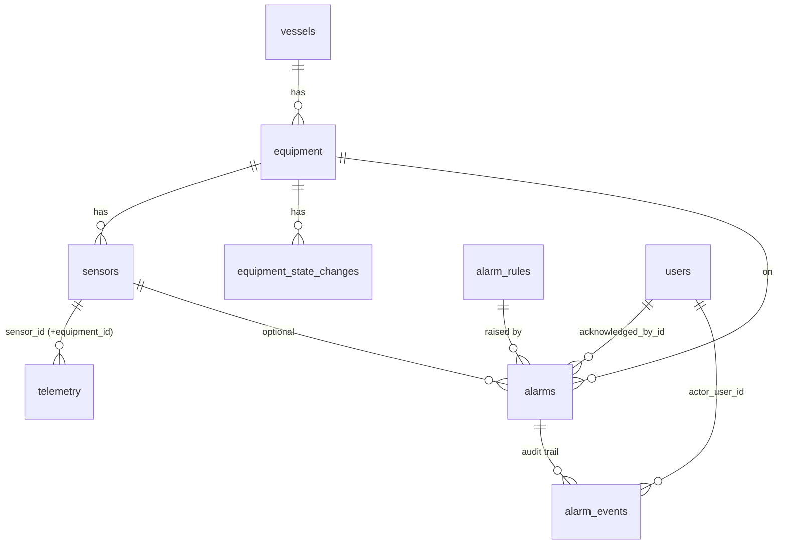

# Data model (PostgreSQL)

Schema is owned by Alembic (`backend/migrations/versions/0001_initial_schema.py`); the application never creates
tables itself. All timestamps are `timestamptz` (UTC). `alembic check` is part of the test-suite
(`tests/test_migrations.py`) so models and migrations cannot drift.

| Table | Purpose / key design points |
|---|---|
| `users` | `username` unique, Argon2id `password_hash`, `role` ∈ {viewer, operator} (CHECK) |
| `vessels`, `equipment` | Inventory. `UNIQUE(vessel_id, code)`; `equipment.current_state/state_since` mirror the newest state change |
| `sensors` | Measurement catalogue: unit, physical plausibility range (used to reject impossible values), nominal range, flat-line check flag. `UNIQUE(equipment_id, key)` |
| `telemetry` | One row per measurement. **PK `(sensor_id, source_ts)`** is the idempotency key (duplicates are `ON CONFLICT DO NOTHING`). `ingested_ts` = backend receive time, `source_ts` = time the source measured it. `value` is NULL for non-finite / Bad-status readings; `quality` ∈ good/uncertain/bad/invalid/stuck. Composite FK `(sensor_id, equipment_id)` keeps the redundant `equipment_id` column consistent. Index `(equipment_id, source_ts)` serves the dominant "equipment + time range" access pattern; the PK serves per-sensor charts |
| `equipment_state_changes` | State history (only changes are stored). `UNIQUE(equipment_id, source_ts)` |
| `alarm_rules` | Configuration (thresholds, hysteresis, persistence, severity). CHECK constraints on kind/severity/comparison |
| `alarms` | One row per alarm instance; partial unique index prevents two open alarms for the same rule/equipment/sensor. Stores trigger value/time, threshold snapshot, ack info (`acknowledged_by` username kept for audit), `occurrence_count` |
| `alarm_events` | Append-only state-transition audit trail (raised / acknowledged / cleared / reactivated) with actor, event time, value, note, JSON details |
| `simulator_events` | Audit of operator commands sent to the simulator (actor, action, scenario, result, message) |
| `system_events` | Operational events (OPC UA connected / disconnected) shown in the "recent events" feed |

## Query patterns and indexes

| Query | Access path |
|---|---|
| Chart / history of one measurement | PK `(sensor_id, source_ts)` range scan |
| Replay / history of an equipment item | `ix_telemetry_equipment_source_ts` + `sensor_id IN (…)` |
| Keyset pagination | `ORDER BY source_ts, sensor_id` with `(source_ts, sensor_id) > cursor` – no OFFSET |
| Bucketed aggregates | `date_bin()` + `GROUP BY` over the same range scan |
| Latest value per sensor (start-up only) | `LATERAL … ORDER BY source_ts DESC LIMIT 1` on the PK; at runtime "latest" is served from memory |
| Alarm lists | `ix_alarms_state`, `ix_alarms_raised_at`, `ix_alarms_equipment_raised_at` |

Growth: at the default 1 Hz × 20 sensors the table gains ≈ 1.7 M rows/day. `SEATRACE_TELEMETRY_RETENTION_DAYS`
enables an hourly retention job; partitioning (by time) would be the next step for long-lived deployments.

## Seeding

`app/services/seed.py` is idempotent: vessels / equipment / sensors are upserted by natural key, alarm rules are
inserted only when missing (so database-side tuning survives restarts), demo accounts are created or refreshed from
environment variables.
